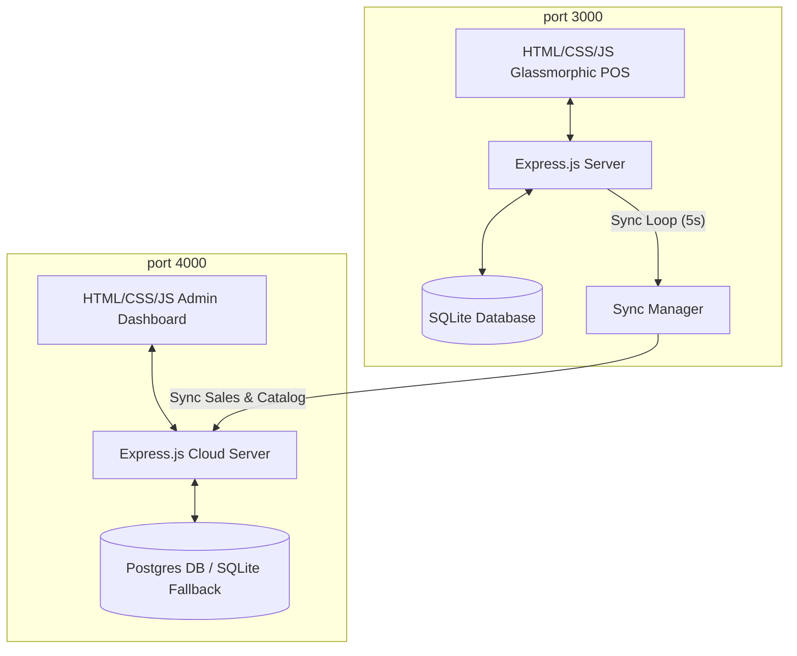

# Sync Retail POS System

An **"Air-Gap Friendly"** Point of Sale (POS) register architecture designed for retail shops, eco-lodges, or remote island resorts that suffer from unreliable or intermittent internet connectivity. 

The system operates 100% locally and offline using an embedded SQLite database, queuing transactions, and automatically synchronizing them with a central PostgreSQL cloud server (with a smart local SQLite fallback) the moment connection is restored.

This project is enhanced with enterprise-grade register drawers, printer formatting, and barcode scanning utilities.

---

## High-Fidelity POS Enhancements

1. **Register Shift Gate & Reconcile Drawer**:
   - Blocks register checkout until cashiers input an opening cash float.
   - Summarizes cash, credit card, and mobile QR sales.
   - closing a shift triggers expected cash balance calculations, shortages/overages, and prompts a print-ready reconciliation audit report.
2. **Audio Synthesizer scan cues**:
   - Synthesizes clean sound frequencies using the HTML5 Web Audio API (no external file dependencies):
     - `success`: High-frequency sine scan beep (cart add/checkout success).
     - `error`: Sawtooth buzzer tone (unopened shift or offline error warnings).
     - `trash`: Frequency-sweeping triangle wave (cart list clears).
3. **Cart-Level Discount Engine**:
   - Supports deduction adjustments as either percentages (`%`) or fixed values (`Rs.`), recalculating subtotals, VAT tax (10%), and grand totals.
4. **Code39 Vector Barcode Sticker Generator**:
   - Renders alphanumeric vector SVG Code39 barcodes client-side without third-party API dependencies.
   - Toggles layouts to print a single sticker label or a sheet of 30 stickers (A4 grid).
5. **Printer-Friendly CSS Overrides**:
   - High-contrast black-and-white print media sheets hide viewport containers (navigation sidebar, product grids, search inputs) to isolate and print thermal receipts, shift audits, and barcode sheets.
6. **Smart SKU Autocomplete & Zero-State Lookup**:
   - Offers real-time name/SKU autocomplete dropdowns with key listener controls (arrows + enter checkout).
   - Clicking an empty search bar displays the top 5 in-stock products as rapid checkout recommendations.
7. **Sri Lankan Rupee (LKR) localization**:
   - Formats all currencies throughout register panels, receipts, and the cloud admin aggregator dashboard in **Rs. / LKR**.

---

## System Architecture



---

## Project Structure

```text
├── local-pos/               # Local register instance application
│   ├── data/                # SQLite database persistence
│   ├── public/              # POS Frontend assets (glassmorphic theme)
│   ├── db.js                # SQLite schema (shifts, sales, products)
│   ├── server.js            # Express API & shift/sync manager endpoints
│   └── Dockerfile           # Docker image setup
│
├── cloud-server/            # Central database aggregator
│   ├── data/                # Fallback SQLite db storage
│   ├── public/              # Admin reporting dashboard
│   ├── db.js                # Postgres DB wrapper with SQLite fallback
│   ├── server.js            # Ingestion endpoints & admin analytics
│   └── Dockerfile           # Docker image setup
│
├── scripts/
│   └── test-sync.js         # Integration E2E test script (including shift gates)
│
├── docker-compose.yml       # Orchestrates local client, cloud server, and DB
└── package.json             # Workspace-level helper scripts
```

---

## Getting Started (Standalone Host Execution)

### 1. Install Dependencies
From the root workspace, run:
```bash
npm.cmd run install-all
```

### 2. Start Cloud Server
In a terminal, run:
```bash
npm.cmd run cloud-server:start
```
*The cloud database will automatically fall back to SQLite if PostgreSQL is unavailable.*

### 3. Start Local POS Server
In a separate terminal, run:
```bash
npm.cmd run local-pos:start
```

### 4. Open Interfaces
- **POS Register Client**: [http://localhost:3000](http://localhost:3000)
- **Cloud Central Dashboard**: [http://localhost:4000](http://localhost:4000)

---

## Running Integration Diagnostics

We have provided a automated test script that runs a complete offline checkout and synchronization test. 

With both servers running, run:
```bash
node scripts/test-sync.js
```

### Test Flow:
1. Validates checkout is locked before a shift is open.
2. Opens a register shift with `Rs. 5,000` float.
3. Toggles network to **OFFLINE**.
4. Checkout transaction, verifying it is stored in local SQLite and linked to active shift ID.
5. Verifies transaction is **absent** from cloud database.
6. Restores connection and forces sync.
7. Asserts local queue is empty and transaction has reconciled in the Postgres/fallback database.
8. Closes the register shift, counting actual cash and verifying Rs. 0 discrepancy.
