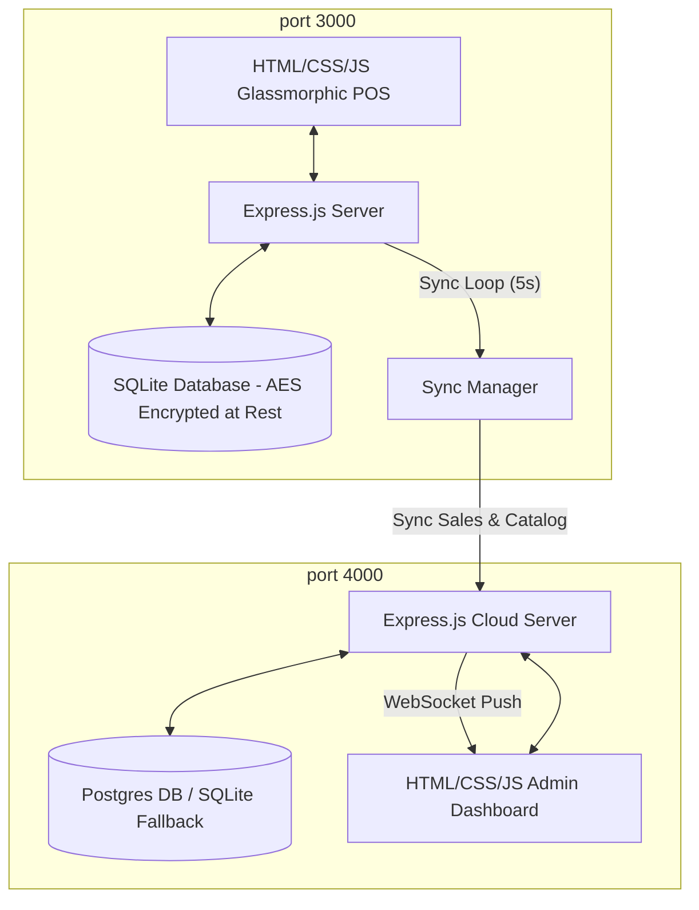

# Sync Retail POS System
### *A Product of [SS Labz](https://ss-labz.pages.dev/)*

An **"Air-Gap Friendly"** Point of Sale (POS) register architecture designed for retail shops, eco-lodges, or remote island resorts that suffer from unreliable or intermittent internet connectivity. 

The system operates 100% locally and offline using an embedded SQLite database, queuing transactions, and automatically synchronizing them with a central PostgreSQL cloud server (with a smart local SQLite fallback) the moment connection is restored.

This project is enhanced with enterprise-grade register drawers, printer formatting, and barcode scanning utilities.

---

## High-Fidelity POS Enhancements

1. **Register Shift Gate & Reconcile Drawer**:
   - Blocks register checkout until cashiers input an opening cash float.
   - Summarizes cash, credit card, and mobile QR sales.
   - Closing a shift triggers expected cash balance calculations, shortages/overages, and prompts a print-ready reconciliation audit report.
2. **Audio Synthesizer scan cues**:
   - Synthesizes clean sound frequencies using the HTML5 Web Audio API (no external file dependencies):
     - `success`: Waveform confirmation scan beep (cart add/checkout success).
     - `error`: Warning buzz tone (unopened shift or offline error warnings).
     - `trash`: Frequency-sweeping triangle wave (cart list clears).
3. **Cart-Level Discount Engine**:
   - Supports deduction adjustments as either percentages (`%`) or fixed values (`Rs.`), recalculating subtotals, VAT tax, and grand totals.
4. **Code39 Vector Barcode Sticker Generator**:
   - Renders alphanumeric vector SVG Code39 barcodes client-side without third-party API dependencies.
   - Toggles layouts to print a single sticker label or a sheet of 30 stickers (A4 grid).
5. **Printer-Friendly CSS Overrides**:
   - High-contrast black-and-white print media sheets hide viewport containers (navigation sidebar, product grids, search inputs) to isolate and print thermal receipts, shift audits, and barcode sheets.
6. **Smart SKU Autocomplete & Zero-State Lookup**:
   - Offers real-time name/SKU autocomplete dropdowns with key listener controls (arrows + enter checkout).
   - Clicking an empty search bar displays the top 5 in-stock products as rapid checkout recommendations.
7. **Sri Lankan Rupee (LKR) localization**:
   - Formats all currencies throughout register panels, receipts, and the cloud admin aggregator dashboard in **Rs. / LKR**.
8. **Hardware Barcode Scanner Integration (Keyboard Emulation)**:
   - Buffers keystroke events occurring at sub-40ms intervals globally to intercept laser scans client-side, bypassing manual textbox input handlers.
9. **Live WebSockets Dashboard Push**:
   - Synchronizes transaction handshakes in real time. Sales synched from POS registers are pushed to cloud dashboards instantly with indigo glow flash animations and updated KPI calculations.
10. **Incremental Catalog Sync**:
    - Replicates catalog modifications using vector timestamp checks. Register clients request only products updated since the maximum local catalog version, reducing network transfer overhead.
11. **Predictive AI Restock Alerts (FastAPI ML forecasting)**:
    - Bridges cloud inventory aggregates with a FastAPI forecasting regressor model. Displays glowing restock indicator status badges (*Safety Alert*, *Reorder Suggested*, *Healthy*) and dynamically draws SVG line charts showing 14-day forecasts.
12. **Local Database Encryption (AES-256-CBC)**:
    - Encrypts sales figures, payment methods, cart items, and shift float variables at rest in SQLite using randomly generated Initialization Vectors (IV).
13. **Cross-Tab Settings Broadcast (HTML5 BroadcastChannel)**:
    - Automatically synchronizes adjustments made in setting tabs (VAT tax rate slider, synthesizer waveform selections), active register shifts, and network toggles across all open register browser tabs.

---

## System Architecture



---

## Project Structure

```text
├── local-pos/               # Local register instance application
│   ├── data/                # SQLite database persistence
│   ├── public/              # POS Frontend assets (glassmorphic theme)
│   ├── db.js                # SQLite schema (shifts, sales, products)
│   ├── crypto.js            # Cryptographic module for column-level encryption
│   ├── server.js            # Express API & shift/sync manager endpoints
│   └── Dockerfile           # Docker image setup
│
├── cloud-server/            # Central database aggregator
│   ├── data/                # Fallback SQLite db storage
│   ├── public/              # Admin reporting dashboard
│   ├── db.js                # Postgres DB wrapper with SQLite fallback
│   ├── server.js            # Ingestion endpoints & admin analytics
│   └── Dockerfile           # Docker image setup
│
├── scripts/
│   ├── test-sync.js         # E2E sync and shift gate verification test
│   ├── test-scanner.js      # Timing-based barcode emulation validator
│   ├── test-incremental.js  # Catalog delta replication validator
│   ├── test-encryption.js   # Raw database encryption-at-rest auditor
│   ├── test-compaction.js   # SQLite storage auto-purge & vacuum compiler
│   ├── test-currency.js     # Multi-currency conversion & exchange calculator validator
│   └── test-watchdog.js     # Database corruption diagnostics and self-healing validator
│
├── docker-compose.yml       # Orchestrates local client, cloud server, and DB
└── package.json             # Workspace-level helper scripts
```

---

## Getting Started (Standalone Host Execution)

### 1. Install Dependencies
From the root workspace, run:
```bash
npm.cmd run install-all
```

### 2. Start Cloud Server
In a terminal, run:
```bash
npm.cmd run cloud-server:start
```
*The cloud database will automatically fall back to SQLite if PostgreSQL is unavailable.*

### 3. Start Local POS Server
In a separate terminal, run:
```bash
npm.cmd run local-pos:start
```

### 4. Open Interfaces
- **POS Register Client**: [http://localhost:3000](http://localhost:3000)
- **Cloud Central Dashboard**: [http://localhost:4000](http://localhost:4000)

---

## Running Integration Diagnostics

We have provided several automated validation suites to test the advanced architecture enhancements. 

### 1. Shift Reconciliation & Sync Audit
Ensures shifting flows are blocked before cash initialization, aggregates transactions offline, and uploads them successfully upon connection restoration:
```bash
node scripts/test-sync.js
```

### 2. Barcode Keystroke Emulation
Validates keyboard events generated under 40ms globally are correctly intercepted:
```bash
node scripts/test-scanner.js
```

### 3. Catalog Delta Incremental Sync
Validates vector clock parameters fetch only changed catalog rows, showing zero-bandwidth when already synchronized:
```bash
node scripts/test-incremental.js
```

### 4. Database-At-Rest Encryption
Directly audits raw SQLite binary files to assert transaction records are stored as encrypted ciphers that fail numerical parsing:
```bash
cd local-pos
$env:NODE_PATH="node_modules"; node ../scripts/test-encryption.js
```

### 5. SQLite Storage Auto-Purge & Compaction
Validates that synced transactions older than the threshold are automatically deleted and space reclaimed on disk:
```bash
cd local-pos
$env:NODE_PATH="node_modules"; node ../scripts/test-compaction.js
```

### 6. Multi-Currency Offline Cashier Assistant
Validates currency exchange preloads in SQLite and verifies conversion calculations:
```bash
node scripts/test-currency.js
```

### 7. Database Integrity Health Watchdog
Simulates database corruption by injecting garbage bytes, restarts the server, and asserts that the corruption is isolated and recovered via delta syncs:
1. Kill the active local-pos server process.
2. Inject corruption:
   ```bash
   node -e "require('fs').writeFileSync('local-pos/data/local_pos.sqlite', 'CORRUPT_BYTES')"
   ```
3. Restart the local POS server (`npm run local-pos:start`).
4. Run diagnostics:
   ```bash
   node scripts/test-watchdog.js
   ```
