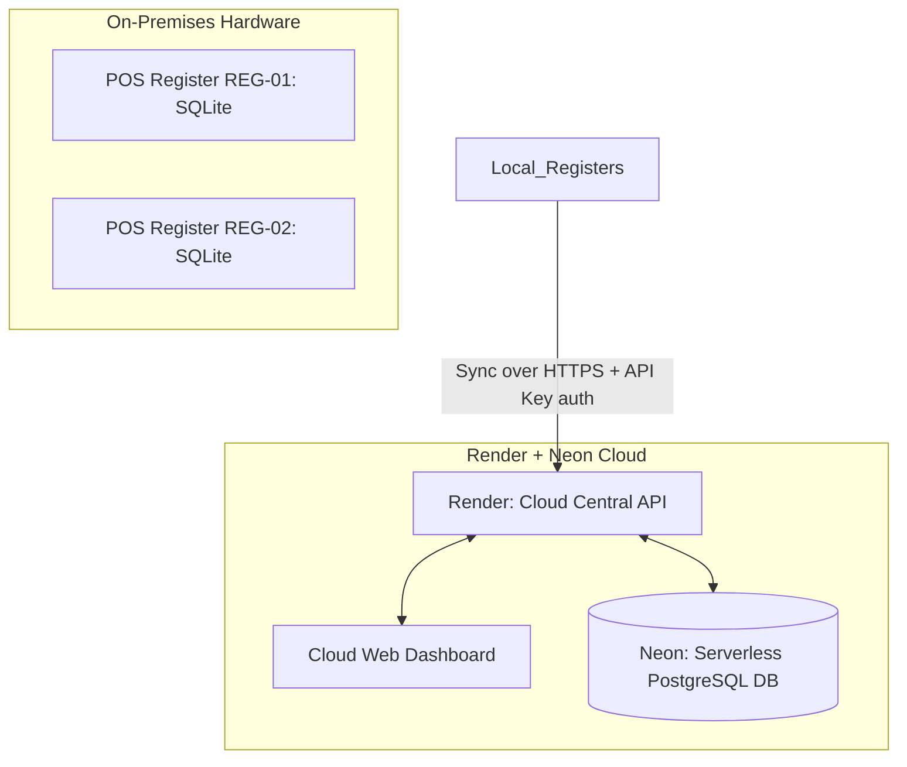

# Sync Retail POS - Production Handover Plan
### *A Product of [SS Labz](https://ss-labz.pages.dev/)*

This document outlines the deployment architecture, configuration guidelines, security rules, and backup policies required to promote the **Sync Retail POS** system from a local development environment to production hosting.

---

## 1. Production Hosting Architecture



### A. Central Cloud Database: Neon (Serverless PostgreSQL)
- **Service**: Serverless Postgres 15 database hosted on [Neon.tech](https://neon.tech).
- **Migration Action**: In production, the SQLite database fallback inside the Cloud Server is disabled. The application requires a connection to Neon.
- **Connection Rule**: SSL connection mode is required (`sslmode=require`).

### B. Central Cloud Server: Render (Web Service)
- **Service**: Node.js Express server hosted on [Render](https://render.com).
- **Domain**: Assigned public endpoint (e.g., `https://sync-retail-cloud.onrender.com`).
- **Environment**: Containerized node environment.

### C. Local POS Terminals: Local Hardware
- **Service**: Installed on local registers (PCs, Raspberry Pi, or POS hardware terminals) running locally on port 3000.
- **Database**: SQLite database file located in `/app/data/local_pos.sqlite` (persisted in a local directory volume).
- **Cloud Pointer**: Configured to sync with the Render public endpoint (`CLOUD_SERVER_URL=https://sync-retail-cloud.onrender.com`).

---

## 2. Environment Configurations (.env templates)

### A. Local POS Register Client Configuration
Create `.env` inside `local-pos/`:
```ini
PORT=3000
REGISTER_ID=REG-01
CLOUD_SERVER_URL=https://sync-retail-cloud.onrender.com
# Secure registration key matching cloud-server config
REGISTER_API_KEY=reg_key_abc123_xyz
# Secret key used to encrypt the local SQLite database at rest (AES-256-CBC)
LOCAL_DB_KEY=sync_retail_secret_pos_key_2026
```

### B. Central Cloud Server Configuration
Create `.env` inside `cloud-server/`:
```ini
PORT=4000
NODE_ENV=production

# Database Connection details (Copy Neon Connection String URI)
DB_HOST=ep-example-1234.us-east-2.aws.neon.tech
DB_PORT=5432
DB_USER=cloud_admin
DB_PASSWORD=neon_db_secure_password
DB_NAME=sync_retail_cloud

# Security Auth Token for Registers
REGISTER_API_KEY=reg_key_abc123_xyz
```

---

## 3. Database Migration & Initialization Sequence

1. **Deploy Neon Instance**: Create the database instance and retrieve the credentials.
2. **First-time Deployment Boot**: When the Cloud Server container launches on Render, it executes `initDb()` on startup:
   - Connects to Postgres.
   - Runs table schemas dynamically (`products`, `sales`, `sale_items`).
   - If products are empty, seeds the core catalog list.
3. **Register Boot**: When the Local POS server starts, it initializes its local SQLite schema:
   - Creates `products`, `sales`, `sale_items`, and `register_shifts` tables.
   - Seeds its local catalog.
   - Performs a synchronization handshake to fetch the latest catalog prices and names from the cloud server.

---

## 4. Production Security Protocol

To safeguard transactional API endpoints in public cloud deployments, implement the following filters:

- **HTTPS Traffic**: Enforce SSL connections for all synchronization requests to prevent sniffing of credit card or sale details.
- **Header Authentication**: The cloud server `/api/sync/sales` and `/api/sync/catalog` endpoints check for an API Key header:
  `X-Register-API-Key`. Requests missing or matching invalid keys are denied with `401 Unauthorized`.
- **Transaction Idempotency**: All sales uploaded by registers must carry their local UUIDs. The cloud Postgres server executes duplicate checks before starting transactions to ensure network retries do not result in duplicate ledger entries.
- **Local SQLite Encryption at Rest**: Encrypt all financial totals, payment methods, transaction item quantities, unit prices, and active shift floats inside the register SQLite database at rest using AES-256-CBC ciphers. Stolen or physically compromised register hardware will not leak store revenue margins or cash drawer float balances.
- **Database integrity Health Watchdog**: Edge registers automatically audit their local databases on start using `PRAGMA integrity_check`. If corruption is detected, the broken database is isolated to `local_pos.sqlite.corrupted-[timestamp]` to prevent server boot failure. The system recovers by initializing a fresh database and pulling catalog values from the central cloud server.

---

## 5. Conflict Resolution & Inventory Reconciliation

- **Inventory Deductions**: Stock deductions are processed on the Cloud server when a transaction is synced.
- **Out-of-Stock Overdrafts**: If an offline sale is synced and the item has since become out-of-stock on the cloud database, the transaction is **still accepted** (refusing finalized cash/card transactions made offline is not possible). The product stock level is decremented below 0 (negative stock) and flagged as "Overdraft" in the dashboard logs for manual warehouse reconciliation.
- **Catalog Synchronization (Incremental Delta Replication)**: The local register client queries the cloud catalog `/api/sync/catalog` passing `?since=MAX_TIMESTAMP`. Pulls and updates only changed products to reduce network overhead. To avoid overriding local stock deductions of offline sales that haven't synced yet, the local POS client computes:
  `local_stock = cloud_stock - (sum of product quantities in unsynced local sales)`
  before saving catalog stock counts back to SQLite (decrypting quantities in memory dynamically to run inventory checks).
- **Multi-Currency Transactions**: While edge registers calculate and display subtotals in foreign currencies (USD, EUR, GBP) using synchronized exchange rate sheets, transactions are synchronized with the cloud using the base LKR currency amounts. Exchange rates are fetched from the cloud server (`GET /api/sync/exchange-rates`) on a background schedule.

---

## 6. Disaster Recovery & Backup Plan

### A. Local POS registers (Offline Database)
- **Local SQLite File Backup**: Set up a daily cron script on the register machine to make copy snapshots of `/app/data/local_pos.sqlite` to an external backup storage device (e.g., SD card or secondary hard drive).
- **SQLite Storage Auto-Purge & Compaction**: To prevent edge registers from exhausting storage space, the application automatically purges synced transaction sales older than `PURGE_THRESHOLD_DAYS` (default 30) from SQLite and runs `VACUUM` disk compaction after sync cycles and shift closures.
- **Rebuilding Terminal**: If terminal hardware fails:
  1. Replace the PC.
  2. Install Node and clone the POS register code.
  3. Start the service. It will pull the entire product catalog from the cloud server and initialize a fresh SQLite file.

### B. Cloud Database (Postgres)
- **Neon Point-in-Time Recovery**: Neon supports automatic hourly backups. In case of database corruption:
  1. Go to Neon console.
  2. Restore to a snapshot state prior to corruption.
  3. All registers will automatically re-attempt syncing any transactions that failed or were lost during recovery since their local SQLite tables retain `synced = 0` status logs for unacknowledged checkouts.
