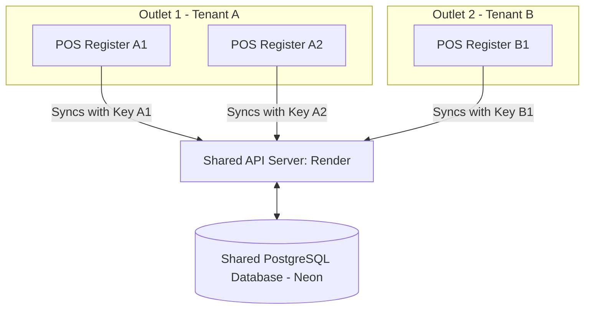
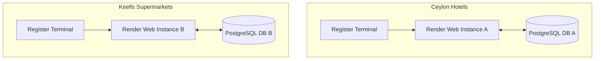

# Sync Retail POS - SaaS Multi-Tenant & Multi-Outlet Architecture Guide
### *A Product Architecture Blueprint by [SS Labz](https://ss-labz.pages.dev/)*

This document provides a technical blueprint for evolving the **Sync Retail POS** system from a single-tenant register fleet into a commercial **Multi-Tenant Software-as-a-Service (SaaS)** platform. It explains data hierarchies, isolation models, registration onboarding, and deployment routes.

---

## 1. Core Data Hierarchy Model

To support enterprise corporate clients who operate multiple retail properties, the platform establishes a structured **4-Tier Data Hierarchy**:

```text
  🏢 Tenant (Enterprise Account - e.g., "Ceylon Supermarkets Group")
     └── 📍 Outlets (Retail Branches - e.g., "Galle Outlet", "Colombo Branch")
           └── 💻 Registers (Cash Drawers - e.g., "Main Lobby POS", "Backdoor Express")
                 └── 📊 Transactions (Shift Ledger, Sales, Local Encrypted Logs)
```

* **Tenant**: The subscribing company entity paying for the SaaS license.
* **Outlet**: A physical storefront location. Stock quantities and tax rates are scoped at the outlet level.
* **Register**: Individual edge terminals syncing data. Each register client carries a unique API key identifying its outlet.

---

## 2. Strategy A: Shared Multi-Tenant SaaS (Logical Isolation)

All subscribing companies share the same cloud hosting resources and database instance. Data isolation is maintained logically via database filters.



### Database Schema Blueprints
Every data table incorporates a `tenant_id` and `outlet_id` to ensure strict query mapping:

```sql
-- Tenants Table (Main Subscriber Account)
CREATE TABLE tenants (
    id SERIAL PRIMARY KEY,
    company_name VARCHAR(255) NOT NULL,
    subdomain VARCHAR(100) UNIQUE NOT NULL,
    status VARCHAR(50) DEFAULT 'active', -- 'active', 'suspended'
    created_at TIMESTAMP DEFAULT CURRENT_TIMESTAMP
);

-- Outlets Table (Store Locations per Tenant)
CREATE TABLE outlets (
    id SERIAL PRIMARY KEY,
    tenant_id INT NOT NULL REFERENCES tenants(id) ON DELETE CASCADE,
    name VARCHAR(255) NOT NULL,
    address TEXT,
    created_at TIMESTAMP DEFAULT CURRENT_TIMESTAMP
);

-- Registers Table (POS Terminal Nodes per Outlet)
CREATE TABLE registers (
    id SERIAL PRIMARY KEY,
    outlet_id INT NOT NULL REFERENCES outlets(id) ON DELETE CASCADE,
    register_name VARCHAR(100) NOT NULL,
    api_key VARCHAR(64) UNIQUE NOT NULL, -- Secret key stored on edge POS config (.env)
    status VARCHAR(50) DEFAULT 'online',
    created_at TIMESTAMP DEFAULT CURRENT_TIMESTAMP
);

-- Sales Table (Scoped Transactions)
CREATE TABLE sales (
    id UUID PRIMARY KEY,
    tenant_id INT NOT NULL REFERENCES tenants(id) ON DELETE CASCADE,
    outlet_id INT NOT NULL REFERENCES outlets(id) ON DELETE CASCADE,
    register_id INT NOT NULL REFERENCES registers(id) ON DELETE CASCADE,
    total_amount DECIMAL(10,2) NOT NULL,
    payment_method VARCHAR(50) NOT NULL,
    created_at TIMESTAMP NOT NULL
);
```

### Onboarding Workflow
1. **Sign-up Action**: The new customer signs up on the landing page, generating a row in the `tenants` table.
2. **Dashboard Subdomain Mapping**:
   - Assigns a subdomain path: `https://enterprise-b.syncpos.com`.
   - When administrators log in, the backend reads the tenant context matching the subdomain and stores the `tenant_id` in their JWT/Session token.
   - All subsequent dashboard queries apply filters:  
     `SELECT * FROM sales WHERE tenant_id = $1`
3. **Register Registration**:
   - The tenant administrator creates an outlet ("Sigiriya Shop") and a register terminal ("Lobby Register") on their dashboard, generating a unique token.
   - The token is saved in the register's local `.env` as `REGISTER_API_KEY`.
   - When the terminal synchronizes transactions, the API resolves the register key, identifying the outlet and tenant context to log transactions correctly.

---

## 3. Strategy B: Dedicated Single-Tenant SaaS (Physical Isolation)

A separate set of cloud instances (Render container and database schemas) is deployed for high-value enterprise accounts.



### Architecture Highlights
* **Zero Data Contamination**: Database connections exist in isolation. There is no risk of cross-company data leakage since the systems are physically separate.
* **White-Label Customization**: Enables different branding, layouts, payment gateway links, and currencies (e.g., USD, LKR, EUR) depending on client locations.
* **Custom Software Versions**: Allows running specific software updates or custom modules for one enterprise without affecting other clients.

### Onboarding Workflow
1. **Resource Provisioning**:
   - Automatically spin up a new serverless Postgres branch/database on Neon (e.g., `sync_pos_enterprise_b`).
   - Trigger a Render template blueprint deployment to launch a separate web instance.
2. **Domain Routing**:
   - Map their corporate portal domain (e.g., `https://pos.enterprise-b.com`) to the newly deployed Render instance.
3. **Register Deployment**:
   - Point edge POS registers directly to the dedicated subdomain sync URL:  
     `CLOUD_SERVER_URL=https://pos.enterprise-b.com`

---

## 4. SaaS Strategy Trade-offs

| Feature | Strategy A: Shared Multi-Tenant | Strategy B: Dedicated Enterprise |
| :--- | :--- | :--- |
| **Operational Costs** | **Extremely Low** (All users share one basic database/compute plan) | **Higher** (Pays database and hosting fees per client) |
| **Deployment Speed** | **Instant** (Simply add database rows via dashboard) | **Minutes** (Requires cloud API provisioning scripts) |
| **Upgrades/Maintenance** | **Single Update** (Push code once to Render to update all clients) | **Separate Deployments** (Must coordinate patches across multiple instances) |
| **Security/Compliance** | Logical Separation (Dependent on strict backend code filter controls) | **Physical Separation** (Meets strict corporate data policy requirements) |
| **Target Audience** | Independent Retailers, Cafes, Spas, and Boutiques | Large Hotel Networks, Supermarket Chains, Global Franchises |

---

## 5. Recommended Implementation Roadmap

If you wish to scale this product, start with **Strategy A (Shared Multi-Tenant)** to construct the multi-location database filters, and then wrap Strategy A inside Docker templates to easily support **Strategy B (Dedicated)** when onboarding high-value enterprise clients.
